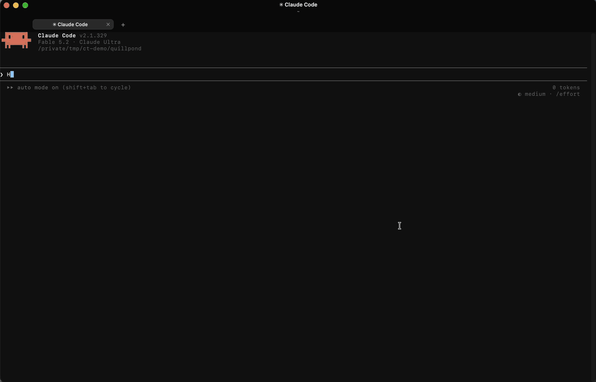

# ClaudeTerminal

A small native macOS terminal for [Claude Code](https://claude.com/claude-code) with one feature:
**⌘L opens the whole transcript of the session in the current tab, and filters it as you type.**

Claude Code runs in the terminal's alternate screen, so there is no scrollback to search, and long
sessions get big: my largest transcript is 136 MB. ⌘L reads the session's JSONL file instead and
shows the conversation folded to your own messages. Each one unfolds to what Claude did in reply.



*The recording is a real Claude Code session on top of a mock history: 2,400 invented turns (79 MB),
with the one real exchange at the end.*

## How fast

A 136 MB transcript (23,463 lines, 677 turns) on an M3 Max, medians of 5 runs:

| | First version | Now |
|---|---|---|
| Open | 2.5 s | 0.1 s |
| Reopen | reads the file again | 0.02 s |
| Filter | 40–110 ms | 5–20 ms |
| Peak memory | 910 MB | about 250 MB |

The numbers come from the built-in benchmark (see [Checking it](#checking-it)) and move by about
a fifth from run to run.

## How it got there

1. **Skip before parsing.** Tool results are about three quarters of a long session's bytes and
   are never shown. Those lines, metadata lines and thinking-only lines are rejected by matching a
   few raw bytes, so they never reach the JSON parser.
2. **No giant string.** Line breaks are found in the raw bytes, and the file is read in 16 MB
   chunks, with the next chunk fetched while the current one parses.
3. **Every core.** The lines that survive are parsed in parallel and stitched back in order.
4. **Measure less, off the main thread.** Text heights come from a private text-layout stack on
   background threads, and only for what is on screen.
5. **Draw less.** Only the rows near the viewport exist as views.
6. **Remember.** The parsed transcript and the measured heights are kept per file, so reopening
   reads only what was appended. While the overlay is open it follows the session live.

The original parser is kept as a reference, and the fast one is checked against it.

## Keys

| Key | |
|---|---|
| ⌘L | Open or close the transcript |
| type | Filter by your message or Claude's reply |
| ↓ or Return | Move from the filter box into the list |
| j / k or ↑ / ↓ | Move the selection |
| Space | Unfold or fold the selected turn |
| A | Unfold or fold everything |
| / | Back to the filter box |
| Esc | Clear the filter, then close |

## Which transcript ⌘L opens

By default, the newest session file for the tab's working directory. To make it exact when
several sessions share a directory, add the hook in [`Tools/hooks/`](Tools/hooks) (it needs `jq`)
to `~/.claude/settings.json`:

```json
{
  "hooks": {
    "SessionStart": [{"hooks": [{"type": "command",
      "command": "~/.claude/hooks/claude-transcript.sh"}]}],
    "UserPromptSubmit": [{"hooks": [{"type": "command",
      "command": "~/.claude/hooks/claude-transcript.sh"}]}]
  }
}
```

It writes one private escape sequence, `ESC ] 7779 ; <transcript path> BEL`, to the terminal
Claude runs on, prints nothing, and does nothing outside ClaudeTerminal.

## What it shows

- Your messages, Claude's text, and tool calls as one line each.
- Not shown: tool results and thinking.
- Known gap: a message typed while Claude is still working is stored differently by Claude Code
  and does not appear yet.

## The rest

A plain terminal around it: tabs you can reorder and tear off into windows, a header with the
working directory and git branch, find in scrollback (⌘F), and a picker for recent Claude
projects (⌘T). New projects are created in `~/Work`; change that with
`defaults write io.github.nickoh-821.claudeterminal ProjectsFolder "~/Code"`.

Built on [SwiftTerm](https://github.com/migueldeicaza/SwiftTerm), vendored with local fixes.
About 3,650 lines of Swift and AppKit, no other dependencies.

## Build

```bash
git clone https://github.com/nickoh-821/claude-terminal.git
cd claude-terminal
swift build -c release
./make-app.sh     # wraps the binary into ClaudeTerminal.app and installs it to /Applications
```

Requires macOS 13+ and Swift 5.9.

## Checking it

```bash
ClaudeTerminal --perf-bench FILE...          # open, filter, fold and live-tail timings
ClaudeTerminal --perf-verify [FILE...]       # fast parser against the original, on every local transcript
ClaudeTerminal --perf-snapshot FILE OUTDIR   # renders the overlay to PNGs, for comparing two builds
```
